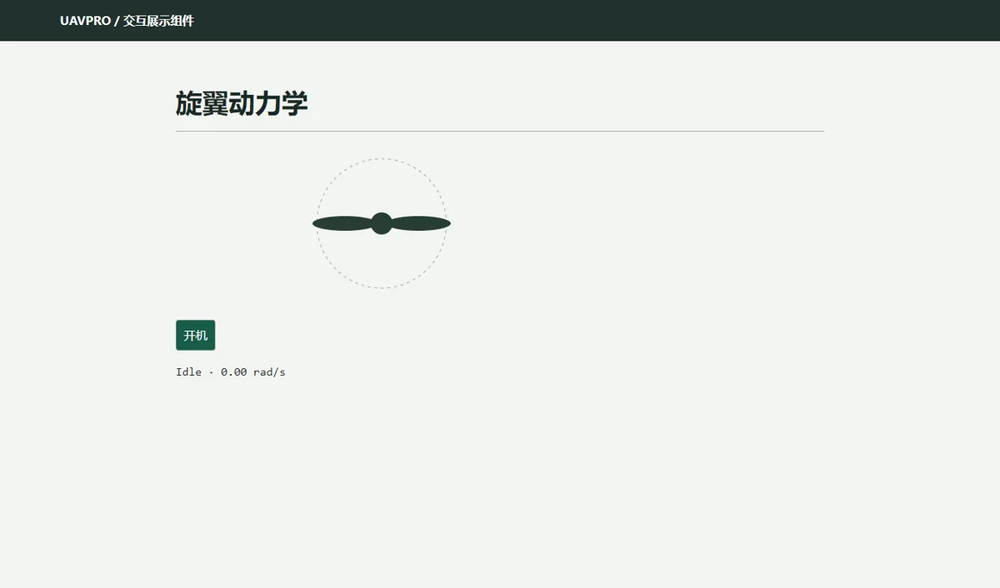
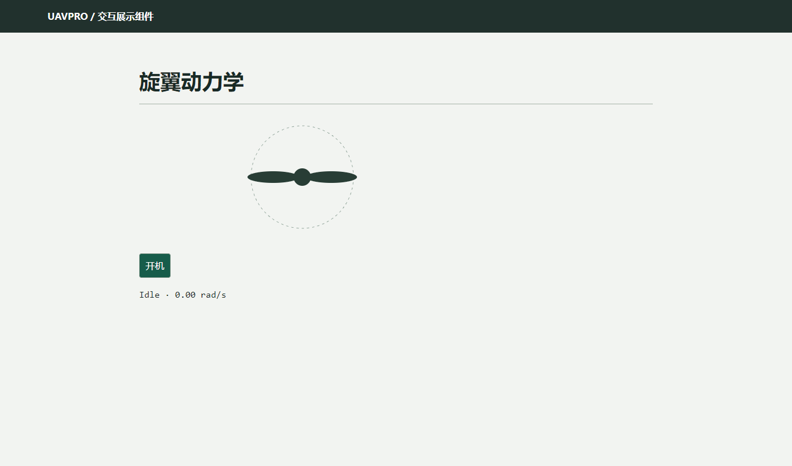

# UAVPRO 旋翼展示组件

从 UAVPRO 无人机商店的商品预览中提取旋翼动态模块，运行同一套加速和滑行逻辑，无需商业商品模型。

## 实际界面巡览



上图由两张本次实际运行画面的截屏轮换组成，不是连续操作录像。

| 静止旋翼 | 断电滑行 |
| --- | --- |
|  |  |

## 可以做什么

- 点击开机，观察角速度趋近目标值
- 断电时保持连续滑行
- 以 rad/s 查看当前速度

## 本地运行

```sh
python -m http.server 8000 --bind 127.0.0.1
```

在浏览器打开 `http://127.0.0.1:8000/`。只监听本机；不执行部署。

## 实测与范围

电机加速至 Running；断电后在动画帧中验证 Coasting。

原始模块来自商品查看器；公开版用示意旋翼代替厂家三维模型。不是含商品库、订单和后台的整站发布。

[手机宽度实机截屏（390 px）](showcase/03-mobile.png) · [授权范围](LICENSE) · [来源与署名](NOTICE.md)
